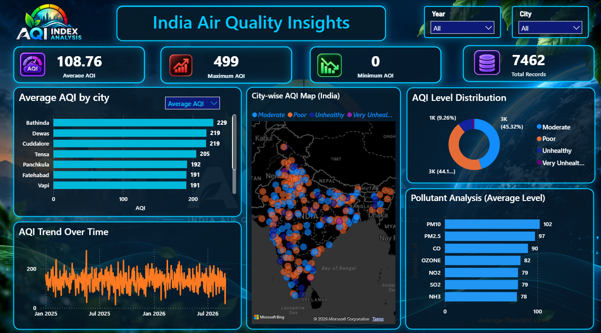
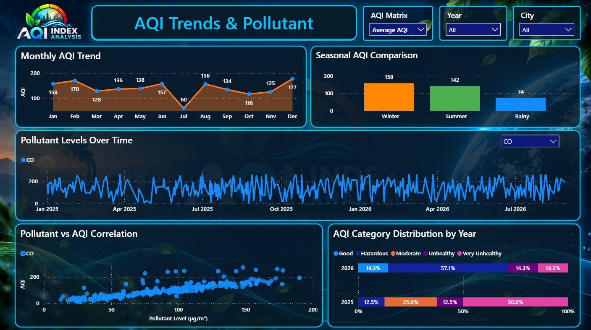
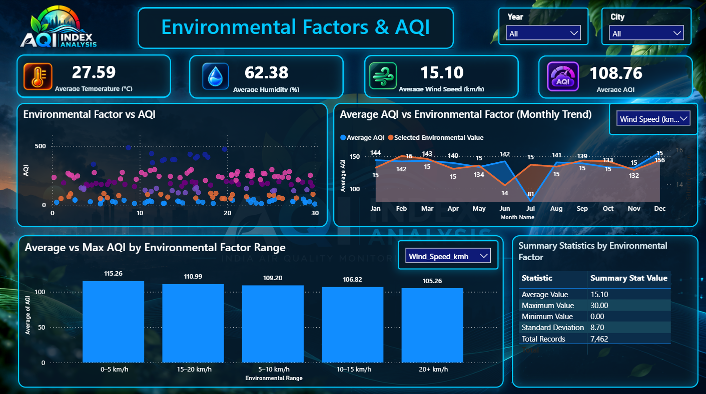

# India Air Quality Insights — Power BI Dashboard

An interactive Power BI dashboard for analysing air quality across Indian cities, comparing pollutant levels, exploring AQI trends, and understanding how environmental factors are associated with air quality.

## Project Overview

**India Air Quality Insights** is a data analytics project developed using Microsoft Power BI. It transforms air-quality data into interactive visualisations to help users explore city-wise AQI, pollutant levels, seasonal differences, and environmental conditions.

The dashboard contains **three pages**:

1. **National AQI Overview**
2. **AQI Trends & Pollutant Analysis**
3. **Environmental Factors & AQI Analysis**

## Dataset

- **Dataset:** India Air Quality Dataset (2025–2026)
- **Source:** [Kaggle — India Air Quality Dataset](https://www.kaggle.com/datasets/yogeshm01/india-air-quality-dataset-20252026)
- **Dataset Creator:** yogeshm01
- **Main File:** `enriched_aqi_dataset.csv`
- **Source Dataset Size:** 10,521 rows and 22 columns

### Dataset Contents

The dataset contains fields related to:

- Country, state, city, and monitoring station
- Latitude and longitude
- Date and time
- Air Quality Index (AQI) and AQI categories
- Pollutant identifiers and pollutant measurements
- Temperature, humidity, and wind speed

### Data Quality Note — State Column

During data cleaning, the `state` column was found to contain inconsistent and incorrectly entered values. These entries could lead to incorrect state-wise grouping and misleading comparisons.

Therefore, **the state column was excluded from the final analysis** rather than using unreliable state classifications. City-level and geographical fields were retained for the city comparison and map visualisations.

### Reporting Period

The dashboard was intended to cover data through September 2026, excluding records from 2027.

**Record count note:** The source dataset contains 10,521 rows, while the dashboard's Total Records KPI displays 7,462 in the current report view. The displayed count reflects the processed model and its counting logic; it should not be confused with the original CSV row count.

## Dashboard Pages

### Page 1 — National AQI Overview

This page provides an overall view of air quality across Indian cities.

#### Key Performance Indicators (KPIs)

- **Average AQI:** Shows the average AQI for the selected data.
- **Maximum AQI:** Shows the highest recorded AQI.
- **Minimum AQI:** Shows the lowest recorded AQI.
- **Total Records:** Displays the record count according to the report's calculation.

#### Visualisations

- **Average AQI by City:** Compares average AQI across cities and helps identify locations with higher readings.
- **City-wise AQI Map:** Displays geographical AQI observations across India.
- **AQI Level Distribution:** Shows how observations are distributed across AQI categories.
- **AQI Trend Over Time:** Displays AQI changes across dates.
- **Pollutant Analysis:** Compares average levels of different pollutants.

#### Filters

- Year
- City
- AQI metric selector where applicable

### Page 2 — AQI Trends & Pollutant Analysis

This page focuses on changes in air quality over time, seasonal comparisons, and pollutant analysis.

#### Visualisations

- **Monthly AQI Trend:** Compares average AQI across the twelve months.
- **Seasonal AQI Comparison:** Compares average AQI across the defined seasons.
- **Pollutant Levels Over Time:** Tracks the selected pollutant across dates.
- **Pollutant vs AQI Correlation:** Uses a scatter plot to explore the relationship between pollutant concentration and AQI.
- **AQI Category Distribution by Year:** Compares the percentage distribution of AQI categories between 2025 and 2026.

#### Season Classification

The following seasonal groupings were created for this project:

| Season | Months |
|---|---|
| Summer | March–June |
| Rainy | July–October |
| Winter | November–February |

These are the project's defined seasonal groupings used for comparison.

#### Filters

- AQI Metric
- Year
- City
- Pollutant selector

### Page 3 — Environmental Factors & AQI Analysis

This page explores how temperature, humidity, and wind speed are associated with AQI.

#### Key Performance Indicators

- Average Temperature (°C)
- Average Humidity (%)
- Average Wind Speed (km/h)
- Average AQI

#### Visualisations

- **Environmental Factor vs AQI:** A scatter plot comparing the selected environmental factor with AQI, with colours representing AQI categories.
- **Average AQI vs Environmental Factor (Monthly Trend):** Compares monthly AQI with the selected environmental measurement using a secondary axis.
- **Average AQI by Environmental Factor Range:** Compares average AQI across ranges of temperature, humidity, or wind speed.
- **Quick Insights:** Dynamically identifies the ranges with the highest and lowest average AQI for the selected environmental factor.
- **Summary Statistics:** Displays the average, maximum, minimum, standard deviation, and record count for the selected factor.

#### Environmental Factor Selector

The interactive selector supports:

- Temperature (°C)
- Humidity (%)
- Wind Speed (km/h)

It allows the environmental analysis to change without requiring a separate chart for each factor.

## Data Cleaning and Transformation

Power Query was used to prepare the data for analysis.

Key steps included:

- Checking and converting data types.
- Selecting relevant fields for analysis.
- Removing the unreliable `state` column because of inconsistent entries.
- Organising date, location, and pollutant information into supporting tables.
- Creating dimension tables for dates, locations, pollutants, and city mapping.
- Creating a separate `Fact_Environmental` query by referencing `Fact_AQI`.
- Unpivoting `Temperature_C`, `Humidity_%`, and `Wind_Speed_kmh` into two columns: `Environmental Factor` and `Environmental Value`.
- Creating an `Environmental Range` column to group environmental measurements into readable ranges.
- Creating a Season column based on the project's month classification.
- Adding a `Record_Id` index to identify source observations in the environmental query.

These transformations support interactive environmental analysis and range-based comparisons.

## Data Model

The Power BI model includes fact, dimension, and supporting analytical tables:

- `Fact_AQI`
- `Fact_Environmental`
- `Dim_Date`
- `Dim_Location`
- `Dim_Pollutant`
- `Dim_City_Map`
- `City_AQI`
- `AQI Metric` field parameter

`Fact_Environmental` is a transformed query created from `Fact_AQI` to analyse environmental measurements using a common structure.

## DAX and Analytical Calculations

DAX measures and calculations support the dashboard's KPIs, dynamic selections, and analytical summaries.

Examples include:

- Average AQI
- Maximum AQI
- Minimum AQI
- Average Temperature
- Average Humidity
- Average Wind Speed
- Selected Environmental Value
- Quick Insight
- Summary Stat Value

The environmental selection logic returns the measurement corresponding to the chosen factor. The Quick Insight measure compares average AQI across environmental ranges, while Summary Stat Value returns the selected statistic for display.

Power Query handles several data-preparation, grouping, and range-classification operations. Not every visual requires a custom DAX measure.

## Interactivity

The dashboard includes:

- Year and City slicers
- AQI Metric selection
- Pollutant selection
- Environmental Factor selection
- Cross-filtering between compatible visuals

These controls allow users to explore different cities, time periods, pollutants, and environmental conditions.

## Tools and Technologies

- **Microsoft Power BI:** Dashboard development and interactive visualisations
- **Power Query:** Data cleaning and transformation
- **DAX:** Measures and dynamic calculations
- **Data Modelling:** Fact tables, dimension tables, and relationships
- **Kaggle:** Dataset source

## Key Analytical Questions

The project explores questions such as:

- Which cities have higher average AQI?
- How does AQI change over time?
- How do AQI categories differ between years and seasons?
- Which pollutants have higher average measured levels?
- How are pollutant concentrations associated with AQI?
- How does average AQI vary across temperature, humidity, and wind-speed ranges?

The dashboard helps identify patterns and associations within the dataset. These patterns alone do not prove that a pollutant or environmental factor caused a change in AQI.

## How to Use

1. Download the Power BI report from this repository.
2. Open `India Air Quality Insights.pbix` using Microsoft Power BI Desktop.
3. Use the available slicers to filter by year, city, pollutant, or environmental factor.
4. Interact with the charts to explore AQI trends and comparisons.

## Repository Structure

```text
India-Air-Quality-Insights/
├── README.md
├── India Air Quality Insights.pbix
└── screenshots/
    ├── Page-1-National-AQI-Overview.png
    ├── Page-2-AQI-Trends-Pollutants.png
    └── Page-3-Environmental-Factors.png
```

## Dashboard Screenshots

### Page 1 — National AQI Overview



### Page 2 — AQI Trends & Pollutant Analysis



### Page 3 — Environmental Factors & AQI Analysis



## Data Source and Attribution

Dataset: [India Air Quality Dataset (2025–2026) — Kaggle](https://www.kaggle.com/datasets/yogeshm01/india-air-quality-dataset-20252026)

The dataset is attributed to its creator on Kaggle. Refer to the original dataset page for its licence and reuse conditions.

---

**Project:** India Air Quality Insights  
**Platform:** Microsoft Power BI  
**Focus:** AQI Analysis, Data Visualisation, Pollutant Trends, and Environmental Factors

---

## Author and Acknowledgement

Created by **Harshit Jaiswal**, M.Sc. Data Science student at **NMIMS Mumbai**, as a *Storytelling with Data* practical project under the guidance of **Kavita Ma'am**.

**GitHub:** [@harshitt018](https://github.com/harshitt018)

## Important Note

This dashboard presents an analysis of the dataset used for this academic project. The findings should be interpreted in the context of the dataset's limitations and should not be treated as proof of cause-and-effect relationships.

---
